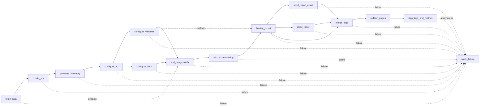

#### Lines: (5740 Python) (580  Pipeline) (512  Terraform) (330  Ansible)

# VM Creation Automation

Ticket-driven VM provisioning for Abramad. When a Jira Service Management (JSM) request reaches the provisioning state, a GitLab CI pipeline reads the ticket, validates it against vCenter and NetBox, creates the VM(s) with Terraform, prepares Active Directory, Linux and the Windows guests with Ansible, creates DNS records in addition to Host and URL monitoring by Zabbix, publishes an HTML report to GitLab Pages, e-mails it, comments and closes the ticket. Every job writes structured logs that are shipped to Elasticsearch. Stage timings, per-job statuses and jira data fetcher and validator are pushed to the Prometheus Pushgateway.

## Contents

1. [Overview](#1-overview)
2. [How a run starts](#2-how-a-run-starts)
3. [Pipeline](#3-pipeline)
4. [How a ticket becomes infrastructure](#4-how-a-ticket-becomes-infrastructure)
5. [Repository layout](#5-repository-layout)
6. [Component reference](#6-component-reference)
7. [GitLab CI/CD variables](#7-gitlab-cicd-variables)
8. [Configuration dictionaries](#8-configuration-dictionaries-scriptsconfigspy)
9. [Observability and alerts](#9-observability-and-alerts)
10. [Reports and GitLab Pages](#10-reports-and-gitlab-pages)
11. [Operations](#11-operations)
12. [Troubleshooting](#12-troubleshooting)

---

## 1. Overview

| Concern | Tool |
|---|---|
| Request intake | Jira Service Management (`SERVICDESK` tickets) |
| Orchestration | GitLab CI, every job runs in the custom `tap` image |
| VM provisioning | Terraform 1.13 and `vmware/vsphere` provider 2.16.1, GitLab-managed HTTP state, **one state per ticket** |
| Guest and AD configuration | Ansible (WinRM for Windows and the domain controller, SSH for Linux) |
| IPAM | NetBox (public IP reservation) |
| DNS | Changes pushed to the BIND project |
| Monitoring | Customer Zabbix (URL monitoring, Windows agent), Prometheus Pushgateway (data fetcher health, stage timings, job statuses), GitLab pipeline exporter |
| Logging | Filebeat ships every `automation.*.log` to Elasticsearch (index `automation-log-YYYY.MM`), that is searchable in Kibana. |
| Reporting | HTML report per ticket on GitLab Pages, e-mailed to the customer contact, linked in the Jira closing comment |
| Notifications | Mattermost (failure channel and notify channel) |


## 2. How a run starts

Every job has `rules: if: $CI_PIPELINE_SOURCE == "trigger"`, so pipelines exist **only** when started through the GitLab pipeline trigger API (not on push or merge request). The Jira automation rule calls it when a ticket enters the provisioning state:

```bash
# Manual Triggering
curl --fail -X POST \
  -F token=<TRIGGER_TOKEN> \
  -F ref=main \
  -F "variables[JIRA_TICKET_KEY]=SERVICDESK-12345" \
  -F "variables[JIRA_TARGET_DATACENTER]=vanak" \
  -F "variables[JIRA_TARGET_PRODUCTLINE]=rahkaran server" \
  https://gitlab.abramad.com/api/v4/projects/<PROJECT_ID>/trigger/pipeline
```

The Jira automation rule sends three values in the webhook body, and all of them are read by `configs.py`:

| Variable | Set by | Used for |
|---|---|---|
| `JIRA_TICKET_KEY` | Jira automation body | Ticket to process; Terraform state name, report path, logs and Jira calls |
| `JIRA_TARGET_DATACENTER` | Jira automation body | `datacenter` label of the pipeline metrics. |
| `JIRA_TARGET_PRODUCTLINE` | Jira automation body | `product_line` label of the pipeline metrics. |

Everything else is read from the ticket. The datacenter and product line values are used **exactly as Jira sends them** (for example `vanak`, `bi server`), so they also appear unchanged as metric label values.
`JIRA_SRV` (project variable, `test` or `main`) selects which set of Jira custom field IDs in `jira_field_dict` is used. It is **not** a server address.

## 3. Pipeline

### Overview

```mermaid
flowchart LR

    subgraph Reconnaissance
        F[fetch_data]
    end

    subgraph Terraform
        C[create_vm]
    end

    subgraph Ansible
        G[generate_inventory]
        AD[configure_ad]
        W[configure_windows]
        L[configure_linux]
    end

    subgraph DNS
        D[add_dns_records]
    end

    subgraph Zabbix
        Z[add_url_monitoring]
    end

    subgraph Reporting
        R[finalize_report]
        E[send_report_email]
        X[close_ticket]
        M[merge_logs]
        P[publish_pages]
    end

    subgraph LogShipping[Log shipping]
        S[ship_logs_and_metrics]
    end

    F --> C
    C --> G
    G --> AD
    AD --> W
    AD --> L

    L --> D
    W --> D
    D --> Z

    Z --> R

    R --> E
    E --> X
    X --> M
    M --> P
    P --> S
```


### Flow



Jobs are connected with `needs:`, so a job starts as soon as its dependencies finish. Stages are only a grouping, with one exception: `ship_logs_and_metrics` has no `needs`, so it waits for **every** job of the earlier stages (and runs even if they failed).

### Jobs

| Stage | Job | What it does | Main outputs | Failure behaviour |
|---|---|---|---|---|
| reconnaissance | `fetch_data` | Starts the timer, resets the job status metrics, runs `scripts.data_fetcher <ticket>`: reads Jira, validates specs, picks names, templates, datastores and port groups, reserves public IPs in NetBox, writes the report | `vms.tfvars.json`, `reports/<ticket>/index.html`, logs | Runner failures retried. Pushes Pushgateway metrics (data fetcher health and job status) |
| terraform_vm_provision | `create_vm` | Copies tfvars into `terraform/main`, `terraform init`, `terraform apply -auto-approve` (wrapped by `run_and_log`), exports `vm_ids` and `vm_ips` | `vm_outputs.json` | `retry: 0` |
| ansible_vm_provision | `1_generate_inventory` | Builds `ansible/inventory/hosts.yml` from tfvars and Terraform IPs, validates it with `ansible-inventory` | `hosts.yml` | Fails if a VM has no IP |
| | `2_configure_ad` | `configure_active_directory.yml`: OU, groups, users, computer objects | logs | Retried twice on `script_failure` |
| | `3_configure_windows` | `configure_windows_client.yml`: local groups, Zabbix Agent 2 | logs | Retried twice on `script_failure` |
| dns | `add_dns_records` | Adds records to the BIND project (`resource_group: bind_repo`) | logs | Triggers another pipeline to apply new A record addition against Bind |
| zabbix | `add_url_monitoring` | Creates URL monitoring in the customer Zabbix | logs | `allow_failure: true` |
| reporting | `1_finalize_report` | Replaces the `{PRIVATE_IP:<vm>}` placeholders in the report with Terraform IPs | `reports/` | |
| | `2_send_report_email` | E-mails the report | | `allow_failure: true` |
| | `3_close_ticket` | Comments on and closes the Jira ticket with the report, while reporting it as a message in mattermost notify channel | | |
| | `4_merge_logs` | Merges every `automation.<job>.log` into `automation.log` | `automation.log` | |
| | `5_publish_pages` | Builds `log.html` and the `index.html`, commits `reports/<ticket>` to `main` (`[skip ci]`), publishes Pages (`resource_group: pages_publish`) | `public/` | |
| log_shipping | `ship_logs_and_metrics` | Runs **always**, even if earlier jobs failed. Ships every `automation.*.log` to Elasticsearch with Filebeat. In `after_script` it marks the end of the run, prints the timing summary, posts the timing table to the Mattermost notify channel and pushes the time metrics to the Pushgateway | Documents in `automation-log-YYYY.MM`, time metrics | `allow_failure: true` |
| catch_exception | `notify_failure` | Runs only on failure: posts failed jobs and log tails to the Mattermost failure channel, comments on the Jira ticket and moves it to `Failed` | | |

Notes:

- Artifacts expire after one day. The durable record of a run is `reports/<ticket>` in the repository, the Pages site and the documents in Elasticsearch.
- Windows VMs are joined to the domain by Terraform (guest customization), then Ansible moves the computer objects into the customer OU.
- Every job has an `after_script` that runs `send_status_metrics job`. `after_script` runs whether the script passed or failed, so the job status reaches the Pushgateway in both cases.
- Jobs upload `automation.*.log` with `artifacts: when: always`, which is what makes the logs of failed jobs available to `ship_logs_and_metrics`. The merged `automation.log` does not match the `automation.*.log` pattern, so logs are never shipped twice.
- `notify_failure` is in the stage after `log_shipping`, so a failure notification waits for the shipping job.

## 4. How a ticket becomes infrastructure

`scripts/data_fetcher.py` turns the ticket into `vms.tfvars.json` with the keys `vcenter`, `vms` and `ad_info`. The selectors and validators live in `scripts/utility/functions/data_validators.py`.

### Server layout

| Product line | Category | Servers created | Names |
|---|---|---|---|
| Rahkaran Server | R Dev | 1 | `VRD-<base>` |
| | R I | 1 | `VR1-<base>` |
| | R II | 2 (App, DB) | `VR2-<base>-A1`, `VR2-<base>-DB` |
| | R III | 2 + N (DB, LB, N App) | `VR3-<base>-DB`, `VR3-<base>-LB`, `VR3-<base>-A1..AN` |
| Sepidar Server | | 1 | `VSP-<base>` |
| BI Server | | 1 | `VBI-<base>` |
| IaaS Server | | 1 | `VIA-<base>` |
| Managed IaaS Server | | 1 | `VMI-<base>` |
| Automation Server, SahamFasl Server | | 1 | `VAT-<base>`, `VSF-<base>`  |

`<base>` is the `vm_base_name` field (2 to 8 characters). A VM name must be unique in the whole vCenter (case-insensitive); otherwise the run fails.

### Per product line

| Product line | Template | Port group key | vCenter folder | URL |
|---|---|---|---|---|
| Rahkaran R Dev / R I | `RI` | `VRD` / `VRI` | `AbramadCustomers/Rahkaran/<base>` | `https://<base>-r.abramad.cloud` |
| Rahkaran R II / R III | `RII-APP` for App and LB, `RII-DB` for DB (chosen from the VM name) | `VRII` / `VRIII` | same | same |
| Sepidar | `SEP` | `VSP` | `AbramadCustomers/Sepidar/<base>` | none |
| BI | `BI` | `VBI` | `AbramadCustomers/BI/<base>` | `https://<base>-b.abramad.cloud` |
| IaaS | by OS (below) | `VIA` | `AbramadCustomers/IaaS/<base>` | none |
| Managed IaaS | `MIaaS-W22` | `VMI` | `AbramadCustomers/ManagedIaaS/<base>` | none |
| Automation, SahamFasl | **not implemented** | **not implemented** | |

IaaS template by the exact Jira OS text (case-insensitive): `Windows Server 2022` (uses `MIaaS-W22`), `Linux Ubuntu 24.04` (`IaaS-U24`), `Linux Ubuntu 26.04` (`IaaS-U26`), `Linux Rockey 9.8` (`IaaS-R98`), `Linux Oracle 9.0` (`IaaS-O9`). `os_type` is `windows` when the OS text starts with "windows", otherwise `linux`.

### Sizing and placement

- **CPU**: 2 up to `NORMAL_CLUSTER_CPU_LIMIT` / `HIGHPERF_CLUSTER_CPU_LIMIT` cores **per VM**, by the ticket processor type.
- **Memory**: 1 up to `NORMAL_CLUSTER_RAM_LIMIT` / `HIGHPERF_CLUSTER_RAM_LIMIT` GB **per VM**, converted to MB for Terraform.
- **Disks**: up to five per role (App, DB, LB). Each disk has a size and a tier (`standard`, `advanced`, `pro`, `ultra`) that maps to a datastore cluster in `vcenter_dict`. The datastore with the most remaining capacity below `DATASTORE_MAX_UTILIZATION` is chosen. Space already assigned to earlier disks of the same VM is reserved during the selection.
- **Compute cluster**: by processor type (`High Performance Processor`, `Normal Processor`).
- **Custom attributes**: `CompanyName`, `Creation Date` (Jalali, Tehran time), `Creation Ticket ID`, `National ID`, `NativeBackup`, `Physical Dongle`, `IDS/IPS`, `WAF Service`, `Site-to-Site VPN`, `Owner`, `ProductLine`, `Business Value`, `RepMail`, `RepName`, `RepNumber`; plus `Industry` (Rahkaran), `URL` and `Public IP`, `Link-VraServer` (BI), `Sepidar-Lock` (Sepidar).

### Public IP

When `public_ip_needed` is set, an address is reserved in NetBox from the best prefix of the datacenter scope (`vanak` or `ME`, target `customers`). Rahkaran R I gets it on the main server, R II on the App server, R III on the LB; every other product line gets one per VM.

### Customer, AD and folders

- New customer: AD OU is the VM base name and the vCenter folder is derived from it. Existing customer: the OU and folder come from the ticket fields.
- Groups per customer: `<OU>Deploy`, `<OU>Support`, `<OU>Members`, `<OU>Computers`, and one `<OU><hostname>Members` per VM.
- Users: the **agent** (username is the national ID; member of `ADSelfServiceEnrollment` and `<OU>Members`) and, when all deployer fields are filled, a **deployer** (placed in `OU=Deploy`; member of `ADSelfServiceEnrollment`, `DeployMembers`, `<OU>Deploy`).
- Private IPs are not set by the pipeline: VMs are cloned without `ipv4_addr` (DHCP) and Terraform reports the address used by Ansible and the report.

## 5. Repository layout

```
.
├── .gitlab-ci.yml
├── README.md
├── ansible/
│   ├── ansible.cfg
│   ├── requirements.yml
│   ├── inventory/hosts.yml              generated on every run
│   ├── playbooks/                       configure_active_directory / configure_windows_client / configure_linux_client
│   └── roles/
│       ├── configure_active_directory/
│       └── configure_windows_client/
├── docker/                              build context of the "tap" image
├── elasticsearch/
│   └── filebeat/filebeat.yml            Filebeat config used by ship_logs_and_metrics
├── reports/<TICKET>/                    index.html, log.html committed by 5_publish_pages
├── scripts/
│   ├── configs.py
│   ├── data_fetcher.py
│   └── utility/{ansible,dns,email,functions,gitlab,jira,log,mattermost,pipeline,webpage,zabbix}/
└── terraform/
    ├── main/                            root module, backend and providers
    └── modules/vm/                      VM module
```

## 6. Component reference

### 6.1 `docker/` (the `tap` image)

Used by every job (`${NEXUS_DOCKER_REGISTRY}/tap:1.0`). Contents: Python 3.12 slim, Terraform 1.13.0, `ansible-core` with `pywinrm` and `requests-ntlm`, collections from `docker/ansible/requirements.yml` (in `/usr/share/ansible/collections`), Python libraries from `docker/python/requirements.txt` (Including `pyzabbix`, `prometheus-client`, `dnspython`, `jira`, `pyvmomi`, `jdatetime`, `pynetbox`, `pyyaml`, `beautifulsoup4`, `python-json-logger`), the **Filebeat 8.19.9** binary (`/usr/local/bin/filebeat`), plus `git`, `jq`, `curl`, `openssh-client`, `sshpass`. The Terraform CLI config points providers to the Nexus mirror. Runs as the non-root user `pipeline`.

Filebeat is copied from the official Filebeat image in a multi-stage build (`FILEBEAT_IMAGE`, default `docker.elastic.co/beats/filebeat:${FILEBEAT_VERSION}`). **`FILEBEAT_VERSION` must match the Elasticsearch cluster version.** The Docker proxy repository in Nexus can be used by overriding `FILEBEAT_IMAGE`.

Build from the `docker/` directory:

```bash
docker build \
  --build-arg HTTP_PROXY=http://proxy.example.com:8080 \
  --build-arg HTTPS_PROXY=http://proxy.example.com:8080 \
  --build-arg NO_PROXY="localhost,127.0.0.1,.abramad.com,.cloud.local,.abramad.cloud" \
  -t ${NEXUS_DOCKER_REGISTRY}/tap:1.0 .
```

Python packages come from the Nexus PyPI proxy. Change `IMAGE_TAG` in `.gitlab-ci.yml` whenever the image changes.

### 6.2 `terraform/`

| Path | Purpose |
|---|---|
| `main/backend.tf` | Empty `http` backend; address, lock and credentials come from `TF_HTTP_*` set in `create_vm` (GitLab-managed state named after the ticket, authenticated with `CI_JOB_TOKEN`) |
| `main/providers.tf` | `vmware/vsphere` 2.16.1. The server comes from `var.vcenter.vc_addr`; user and password are read from `VSPHERE_USER` / `VSPHERE_PASSWORD`. `allow_unverified_ssl = true` |
| `main/variables.tf` | `vcenter`, `vms`, `ad_info`, `domain_join_user`, `domain_join_password`, `local_admin_password`, `custom_attribute_names` |
| `main/main.tf` | Calls `modules/vm`; outputs `vm_ids` and `vm_ips`. Commented placeholders for future `firewall-policy` and `dns-record` modules |
| `main/terraform.tfvars.json.example` | Example of the generated tfvars |
| `modules/vm/` | `data.tf` (lookups), `main.tf`, `variables.tf`, `outputs.tf`, `versions.tf` |

What `modules/vm/main.tf` does:
- Creates one `vsphere_folder` per distinct `vcenter_folder` path.
- Clones each VM from its template into the folder (EFI firmware, CPU and memory hot add on). The VM datastore is the datastore of the **first disk**; every disk is thin provisioned.
- Windows: sets computer name, local administrator password, joins the domain `ad_info.domain` with `domain_join_user` / `domain_join_password` and sets the time zone ID (`ad_info.timezone`, default 160). The AD computer object lands in the default container; Ansible moves it later.
- Linux: sets host name (lower case) and domain. Linux VMs are **not** domain joined.
- Network: DHCP unless `ipv4_addr` is set.
- Writes custom attributes. Keys not listed in `custom_attribute_names` are silently skipped, and the attribute must already exist in vCenter.
- `lifecycle.ignore_changes` covers `num_cpus`, `memory`, `disk` and `clone[0].customize`, so later resizing in vCenter or Jira does not change the VM through Terraform.

Input contract for each VM (`vms` map, key is the hostname):

| Field | Meaning |
|---|---|
| `os_type` | `linux` or `windows` |
| `zabbix_server` | Customer Zabbix server (`vnk-customerzabbix`, `me-customerzabbix`) or null for unmonitored product lines; also used by Ansible |
| `template_name`, `compute_cluster`, `vcenter_folder` | Source and placement |
| `num_cpus`, `memory` | CPU cores count and memory in **MB** |
| `disks[]` | `label` (`disk0`...), `size` (GB), `unit_number`, `datastore` (actual placement). `type` and `storage_cluster` are informational |
| `network` | `portgroup_name`; `ipv4_addr`, `subnet_mask`, `gw_addr`, `dns_*` optional |
| `custom_attrs` | Map of vCenter custom attributes |

### 6.3 `ansible/`

| Path | Purpose |
|---|---|
| `playbooks/configure_active_directory.yml` | Runs the AD role against `domain_controllers` |
| `playbooks/configure_windows_client.yml` | Runs the Windows role against `windows_clients` |
| `playbooks/configure_linux_client.yml` | **Planned**, not called by CI |
| `inventory/hosts.yml` | Generated. Groups `domain_controllers` (`dc01`), `windows_clients`, `linux_clients`; credentials are `lookup('env', ...)` templates, never values. `windows_clients` hosts carry the `zabbix_server` host variable |
| `roles/configure_active_directory` | [Role README](ansible/roles/configure_active_directory/README.md) |
| `roles/configure_windows_client` | [Role README](ansible/roles/configure_windows_client/README.md) |

Playbooks run from `ansible/` with the whole tfvars file as extra vars (`-e "@../vms.tfvars.json"`), so roles can use `ad_info` and `vms`. WinRM uses HTTP 5985 with NTLM; SSH is used for Linux.

### 6.4 `scripts/`

Run as modules from the repository root with `PYTHONPATH=$CI_PROJECT_DIR`, for example `python3 -m scripts.data_fetcher SERVICDESK-12345`.

| Script | Purpose |
|---|---|
| `configs.py` | Environment variables and lookup dictionaries (sections 7 and 8) |
| `data_fetcher.py` | Reads the ticket, builds all VM data, writes `vms.tfvars.json`, the report and Pushgateway metrics |
| `utility/functions/data_validators.py` | Despite the name, it holds: vCenter connection and VM names, `pick_datastore`, name / template / port group / folder / URL / Zabbix / custom attribute selectors, CPU and memory validators, `disk_compactor`, the HTML `reporter()` (which also inserts `FORTICLIENT_DOWNLOAD_URL`), the SMTP sender `send_anonymous_email()`, and `tehran_datetime()` |
| `utility/functions/netbox.py` | NetBox client, best prefix search, IP reservation |
| `utility/ansible/generate_ansible_inventory.py` | Writes the Ansible inventory from tfvars and `vm_outputs.json` |
| `utility/dns/add_dns_records.py`, `dns_resolver.py` | Adds records through the BIND project; resolves names against `DNS_SERVER` |
| `utility/email/send_report_email.py` | Sends the report (uses `MAIL_SERVER`, `CC_EMAIL`). The sender talks plain SMTP on port 25 with no authentication |
| `utility/gitlab/get_failed_jobs.py` | Last 40 log lines of every failed job of the current pipeline |
| `utility/jira/close_ticket.py` | Comments with the report and closes the ticket then sends the report to mattermost notify channel |
| `utility/jira/transition_ticket.py` | Transitions a Jira ticket to an available status |
| `utility/jira/comment_ticket.py` | Comments a message on a Jira ticket |
| `utility/log/logger.py` | JSON logger writing `automation.<job>.log` |
| `utility/log/run_and_log.py` | `run_and_log <ticket> <source> -- <command...>`: runs a command, streams output, strips ANSI codes and stores the whole output as one log record |
| `utility/log/merge_logs.py` | Merges job logs into `automation.log` |
| `utility/mattermost/notifier.py` | Sends messages to mattermost channels by webhook |
| `utility/pipeline/timing.py` | Stage timer: `start` (writes `pipeline_start`), `mark <name>` (one JSON file per mark in `pipeline_timing/`), `summary` (builds the time table, posts it to the Mattermost notify channel and calls `push_time_metrics`) |
| `utility/pipeline/send_time_metrics.py` | `push_time_metrics()`: converts the marks into total and per-stage duration metrics and pushes them to the Pushgateway (section 9.1) |
| `utility/pipeline/send_status_metrics.py` | `reset` marks every job as skipped at pipeline start; `job [name] [status]` pushes the status of the current job (section 9.1). Errors are logged and never fail the job |
| `utility/webpage/*` | Utilizes `generate_log.sh` and `generate_index.sh` to create HTML templates. `patch_report_ips.py` is used to finalize reports |
| `utility/zabbix/add_url_monitoring.py` | URL monitoring in the Vanak or Miremad customer Zabbix |

### 6.5 `elasticsearch/`

| Path | Purpose |
|---|---|
| `filebeat/filebeat.yml` | Filebeat configuration used by `ship_logs_and_metrics` (details and API key creation in section 9.2) |

## 7. GitLab CI/CD variables

**Required** means `configs.py` reads it with `os.environ[...]`; every script that imports `configs.py` fails with `KeyError` if it is missing. Marked every secret as **Masked**.

### 7.1 Defined in `.gitlab-ci.yml`

| Variable | Value | Purpose |
|---|---|---|
| `IMAGE_NAME` | `${NEXUS_DOCKER_REGISTRY}/tap` | Job image repository |
| `IMAGE_TAG` | `1.0` | Job image tag |
| `ANSIBLE_ROLES_PATH` | `${CI_PROJECT_DIR}/ansible/roles` | Role lookup |

### 7.2 Project variables

| Variable | Req. | Used by | Purpose |
|---|---|---|---|
| `NEXUS_DOCKER_REGISTRY` | yes | `.gitlab-ci.yml` | Registry that hosts the `tap` image |
| `JIRA_TICKET_KEY` | yes | everything | Sent by the Jira automation body (trigger variable). Used for the Terraform state name, report path, logs and Jira calls |
| `JIRA_TARGET_DATACENTER` | yes | `fetch_data`, metrics scripts | Sent by the Jira automation body. Datacenter text, used as the `datacenter` metric label |
| `JIRA_TARGET_PRODUCTLINE` | yes | `fetch_data`, metrics scripts | Sent by the Jira automation body. Product line text, used as the `product_line` metric label |
| `JIRA_SRV` | yes | `data_fetcher` | `test` or `main`: selects `jira_field_dict` |
| `JIRA_ADDR` | yes | Jira scripts | Jira base URL |
| `JIRA_TOKEN` | yes | Jira scripts | Jira API token (read ticket, comment, transition) |
| `JIRA_CLOSE_TRANSITION_NAME` | no (`close`) | `close_ticket.py` | Transition used to close the ticket (ID 101 in test) |
| `VSPHERE_USER`, `VSPHERE_PASSWORD` | yes | `data_fetcher`, Terraform provider | vCenter service account. Terraform reads these exact names from the environment |
| `NORMAL_CLUSTER_CPU_LIMIT` | no (`30`) | `cpu_validator` | Maximum vCPU **per VM** for the Normal processor type (minimum is 2) |
| `HIGHPERF_CLUSTER_CPU_LIMIT` | no (`48`) | `cpu_validator` | Same for High Performance |
| `NORMAL_CLUSTER_RAM_LIMIT` | no (`128`) | `memory_validator` | Maximum memory **per VM** in GB for Normal (minimum is 1) |
| `HIGHPERF_CLUSTER_RAM_LIMIT` | no (`256`) | `memory_validator` | Same for High Performance |
| `DATASTORE_MAX_UTILIZATION` | no (`80`) | `pick_datastore` | Maximum datastore usage in percent after the new virtual machine disk is added |
| `DOMAIN` | no (`cloud.local`) | `data_fetcher` | AD domain written to `ad_info.domain` |
| `DOMAIN_JOIN_USER`, `DOMAIN_JOIN_PASSWORD` | yes | `create_vm` (as `TF_VAR_*`) | Account that joins new Windows VMs to the domain |
| `LOCAL_ADMIN_PASSWORD` | yes | `create_vm` (as `TF_VAR_local_admin_password`) | Local administrator password for Windows VMs. The AD role also uses a variable named `local_admin_password` as the initial password of new AD users. Newly created users must change their password via `selfservice.abramad.com`, this is while existing user's password is left intact |
| `AD_SERVER` | yes (Ansible) | inventory | Domain controller address (`dc01`) |
| `AD_ANSIBLE_USER`, `AD_ANSIBLE_PASSWORD` | yes (Ansible) | inventory | WinRM account on the domain controller |
| `WINDOWS_ANSIBLE_USER`, `WINDOWS_ANSIBLE_PASSWORD` | yes (Ansible) | inventory | WinRM account on Windows guests |
| `LINUX_ANSIBLE_USER` | yes (Ansible) | inventory | SSH user for Linux guests |
| `LINUX_SSH_PRIVATE_KEY` | yes (Ansible) | inventory | Must be a **File** type variable: its value is the key path used as `ansible_private_key_file` |
| `NETBOX_URL`, `NETBOX_TOKEN` | yes | `netbox.py` | NetBox API |
| `DNS_SERVER` | yes | `dns_resolver.py` | DNS server used to resolve `abramad.cloud` records |
| `PUBLIC_ZONE` | no (`abramad.cloud`) | DNS scripts | Public zone for records (currently `abramad.cloud`) |
| `BIND_PUSH_TOKEN` | yes | `add_dns_records.py` | Pushes DNS changes to the BIND project via this token (`api`, `write_repository`) |
| `GIT_PUSH_TOKEN` | yes | `5_publish_pages` | Pushes `reports/<ticket>` to `main` (needs `write_repository` and permission on the protected branch) |
| `GIT_API_TOKEN` | yes | `get_failed_jobs.py` | Reads pipeline jobs and traces (`read_api`) |
| `VNK_CUSTOMERZABBIX_URL`, `VNK_CUSTOMERZABBIX_TOKEN` | yes | `add_url_monitoring.py` | Vanak customer Zabbix API |
| `ME_CUSTOMERZABBIX_URL`, `ME_CUSTOMERZABBIX_TOKEN` | yes | `add_url_monitoring.py` | Miremad customer Zabbix API |
| `ZABBIX_AGENT2_VERSION` | yes | `ansible zabbix agent install/upgrade` | Indicates version of Zabbix Agent 2 for installing |
| `PUSHGATEWAY_URL` | yes | `data_fetcher.py`, `timing.py`, `send_time_metrics.py`, `send_status_metrics.py` | Pushgateway address for the data fetcher, stage timing and job status metrics |
| `MATTERMOST_NOTIFY_WEBHOOK` | yes | `timing.py summary`, `close_ticket.py` | Success/Notify channel webhook (vm report and timing table) |
| `MATTERMOST_FAILURE_WEBHOOK` | yes | `notify_failure` | Failure channel webhook for stage errors |
| `MAIL_SERVER`, `CC_EMAIL` | yes | `send_report_email.py` | SMTP server and CC address |
| `FORTICLIENT_DOWNLOAD_URL` | yes | `reporter()` (`fetch_data`) | URL of the latest FortiClient installer, hosted locally. Inserted as the download link of the report page and e-mail |
| `ES_HOST` | yes (log shipping) | `filebeat.yml` | Elasticsearch URL, for example `https://<host>:9200` |
| `ES_API_KEY` | yes (log shipping) | `filebeat.yml` | API key of `filebeat-automation` in `<id>:<api_key>` format (creation in section 9.2). **Masked** |
| `ES_CA_CERT` | yes (log shipping) | `filebeat.yml` | **File** type variable: its value is the path of the cluster CA certificate used to verify the TLS connection |

### 7.3 Set inside jobs (do not create as project variables)

| Variable | Set in | Purpose |
|---|---|---|
| `TF_VAR_domain_join_user`, `TF_VAR_domain_join_password`, `TF_VAR_local_admin_password` | `create_vm` | Terraform sensitive inputs |
| `TF_STATE_NAME`, `TF_ADDRESS`, `TF_HTTP_ADDRESS`, `TF_HTTP_LOCK_ADDRESS`, `TF_HTTP_UNLOCK_ADDRESS`, `TF_HTTP_USERNAME`, `TF_HTTP_PASSWORD`, `TF_HTTP_LOCK_METHOD`, `TF_HTTP_UNLOCK_METHOD`, `TF_HTTP_RETRY_WAIT_MIN` | `create_vm` | GitLab-managed Terraform state per ticket, authenticated by `CI_JOB_TOKEN` |

### 7.4 GitLab predefined variables in use

`CI_PIPELINE_SOURCE` (must be `trigger`), `CI_PROJECT_DIR`, `CI_JOB_NAME` (log file `automation.<job>.log`, `/` and `:` replaced by `_`; also the `ci_job` metric label), `CI_JOB_STAGE` (the `stage` label of the job status metric), `CI_JOB_STATUS` (available only in `after_script`), `CI_JOB_TOKEN`, `CI_API_V4_URL`, `CI_PROJECT_ID`, `CI_PIPELINE_ID`, `CI_PIPELINE_URL`, `CI_PROJECT_NAME`, `CI_PAGES_URL`. The last four of `CI_PIPELINE_ID`, `CI_PIPELINE_URL`, `CI_PROJECT_NAME` are also added to every log document by Filebeat.

## 8. Configuration dictionaries (`scripts/configs.py`)

- **`template_dict`**: product / OS key to vCenter template.
- **`vcenter_dict`**: per datacenter: `addr`, `dc`, `compute_cluster` (by processor type), `storage_cluster` (by tier), `portgroup` (by network code such as `VRI`, `VBI`, `MRI`). Lookups use the key **exactly as written**, so the datacenter text from Jira must match a lower-case key.
- **`jira_field_dict`**: Jira custom field IDs for `test` and `main`: general fields, yes/no flags, agent and deployer contact fields, and App / DB / LB sizing (memory, CPU, disk count, up to five disks with size and type).


## 9. Observability and alerts

| What | How |
|---|---|
| Data fetcher health | `data_fetcher.py` pushes to the Pushgateway: job `python_scripts`, instance `vm_creation_data_fetcher`, target `vm_specs`, label `datacenter`. Metrics: `script_exec_duration_seconds`, `script_success` (1 or 0), `script_last_error_message{error_summary,error_detail}`. Alerts exist on these. |
| Pipeline status | GitLab pipeline exporter scraped by Prometheus (job `gitlab-pipeline-exporter`), rules in 9.3 |
| Job status and stage timing | `send_status_metrics` (every job's `after_script`) and `send_time_metrics` (called by `timing.py summary`) push to the Pushgateway, see 9.1 |
| Why a pipeline failed | `notify_failure` runs `get_failed_jobs.py`: for every failed job it posts name, stage and the last 40 log lines to the Mattermost failure channel, with the pipeline URL and ticket key |
| Stage timing table | `timing.py` writes one JSON file per mark into `pipeline_timing/`. `ship_logs_and_metrics` (`after_script`) posts the table to the Mattermost notify channel. Missing marks show as `skipped` |
| Logs | Every job writes JSON lines to `automation.<job>.log`; `run_and_log` stores the full Terraform / Ansible output as one record (`issue`, `source`, `exit_code`, `line_count`). Filebeat ships them to Elasticsearch (9.2). `4_merge_logs` merges them and `generate_log.sh` renders `log.html` |

### 9.1 Pipeline metrics (Pushgateway)

Both scripts push with the Pushgateway job `vm_provisioning_pipeline`. In Prometheus the series carry the scrape job label `job="vop-pushgateway"` and the pushed job and instance as `exported_job` / `exported_instance`. Every series has the labels `datacenter` and `product_line` (taken from `JIRA_TARGET_DATACENTER` and `JIRA_TARGET_PRODUCTLINE`).

| Metric | Extra labels | `exported_instance` | Meaning |
|---|---|---|---|
| `vm_provisioning_pipeline_duration_seconds` | | `send_time_metrics` | Total run time |
| `vm_provisioning_pipeline_last_run_timestamp_seconds` | | `send_time_metrics` | Unix time of the end of the last run (`log_shipping_end`) |
| `vm_provisioning_pipeline_stage_duration_seconds` | `stage` | `send_time_metrics` | Duration of one stage. Not emitted for a stage whose marks are missing |
| `vm_provisioning_pipeline_stage_skipped` | `stage` | `send_time_metrics` | `1` when a stage has no start or end mark, `0` otherwise |
| `vm_provisioning_pipeline_job_status` | `ci_job`, `stage` | `send_job_status_metrics` | Result of one CI job: `0` success, `1` skipped, `2` canceled, `3` failed |

**Stage timing.** `fetch_data` runs `timing.py start`; jobs then call `timing.py mark <name>` at the end of their script, and the marks travel between jobs in the `pipeline_timing/` artifact. `ship_logs_and_metrics` reads all marks in its `after_script` (`timing.py summary`) and pushes the metrics once per pipeline.

**Job status.** `fetch_data` runs `send_status_metrics reset`, which pushes `skipped` (1) for every job in the `JOBS` map of the script. Then every job pushes its real result from its `after_script`, using `CI_JOB_STATUS` (`success`, `failed`, `canceled`) and `CI_JOB_STAGE`. A job that never runs keeps the value `1`, so after a failure in `create_vm` the later jobs read `1` and `create_vm` reads `3`. Keep the stage values of the `JOBS` map equal to the real `stage:` names of `.gitlab-ci.yml`, otherwise the `stage` label of a job changes once it has run. `notify_failure` is not part of the map.

Limits to be aware of:
- The Pushgateway group is `datacenter` + `product_line` (+ `ci_job` for statuses), **not** the ticket. Two pipelines for the same datacenter and product line that overlap overwrite each other's values, and a new `reset` marks the jobs of the other running pipeline as skipped.
- The Pushgateway keeps the last value until the next run. Use `vm_provisioning_pipeline_last_run_timestamp_seconds` to detect stale data.
- If the runner dies before `after_script`, no status is pushed for that job.
- Metric scripts never fail the pipeline.

Alert rules and a Grafana dashboard on top of these metrics are **in progress**; this section will list them when they are deployed.

### 9.2 Log shipping to Elasticsearch

`ship_logs_and_metrics` runs `when: always` and `allow_failure: true`. It checks that `automation.*.log` files exist, runs `filebeat test config` and `filebeat test output`, then runs Filebeat for at most 30 seconds (`timeout 30`, the exit code 124 of the timeout is accepted) with `--path.data /tmp/filebeat-data`. Documents go to the monthly index `automation-log-YYYY.MM`, so the logs of failed pipelines are available in Kibana (data view `automation-log-*`) even though `4_merge_logs` only runs when the earlier jobs succeed.

Configuration (`elasticsearch/filebeat/filebeat.yml`):

| Setting | Effect |
|---|---|
| `filestream` input on `${CI_PROJECT_DIR}/automation.*.log` with the `ndjson` parser | Each JSON line becomes one document, keys are placed at the top level |
| `drop_event` on empty `message` | Empty lines are ignored |
| `add_fields` target `ci` | Adds `ci.pipeline_id`, `ci.project`, `ci.pipeline_url` to every document |
| `timestamp` from `ts`, then `drop_fields: [ts]` | The UTC `ts` of the log record becomes `@timestamp` |
| `ssl.certificate_authorities: ["${ES_CA_CERT}"]` | Verifies the cluster certificate with the CA file |
| `filebeat.shutdown_timeout: 15s` | Gives Filebeat time to flush before it exits |

**Creating `ES_API_KEY`.** Run this once in Kibana Dev Tools (or with `curl`) as a user allowed to create API keys:

```
POST /_security/api_key
{
  "name": "filebeat-automation",
  "role_descriptors": {
    "automation_log_writer": {
      "cluster": ["monitor"],
      "indices": [
        {
          "names": ["automation-log-*"],
          "privileges": ["auto_configure", "create_doc", "create_index"]
        }
      ]
    }
  }
}
```

- The key can only write to `automation-log-*`: `create_index` and `auto_configure` let Filebeat create the monthly index, `create_doc` lets it add documents, and the `monitor` cluster privilege is what `filebeat test output` needs. It cannot read, update or delete data.
- The response contains `id`, `api_key` and `encoded`. Store `<id>:<api_key>` (joined with a colon) as the masked variable `ES_API_KEY`. The `encoded` value is for HTTP clients and is **not** what Filebeat's `api_key` setting expects. The value is shown only once.
- To rotate, create a new key, update `ES_API_KEY`, then revoke the old one with `DELETE /_security/api_key` and the body `{"name": "filebeat-automation"}` (or its `id`). Add `"expiration": "365d"` to the creation request if the key should expire by itself.
- Keep the Filebeat version in the `tap` image equal to the Elasticsearch version (section 6.1).

### 9.3 Prometheus rules (`gitlab_pipeline_exporter_alerts`)

| Alert | Expression | For | Severity / channel | Meaning |
|---|---|---|---|---|
| `CICDPipelineFailed` | `gitlab_ci_pipeline_status{status="failed"} == 1` | 1m | critical, sms | Latest pipeline of a project / ref is failed (all projects, not only this one). It stays active until the next pipeline of that ref finishes |
| `GitlabPipelineExporterDown` | `up{job='gitlab-pipeline-exporter'} == 0` | 5m | critical, sms | Exporter cannot be scraped: pipeline alerting is blind |
| `VmCreationPipelineSlow` | `gitlab_ci_pipeline_duration_seconds{project="abramad/sysops/automation/vm-creation"} > 1500` | 1m | warning | Last run took longer than 1500 s (25 minutes).|

## 10. Reports and GitLab Pages

Pages URL: `http://abramad.reports.abramad.com/sysops/automation/vm-creation/` (also `${CI_PAGES_URL}`).

- `reports/<TICKET>/index.html` is the **customer report**: a Persian, right-to-left, e-mail style page with the VPN/RDP user name (`<national id>@cloud.local`), instructions to set the password at `selfservice.abramad.com` and the password policy, FortiClient guides for Vanak and Miremad, the FortiClient download link (`FORTICLIENT_DOWNLOAD_URL`, a locally hosted copy of the latest version), and per VM: name, CPU, memory, private IP (`{PRIVATE_IP:<vm>}` placeholder replaced by `1_finalize_report`), public IP, URL and disks. It contains no passwords. The same HTML is the body of the report e-mail.
- `reports/<TICKET>/log.html` is the merged log of the run.
- The Pages root is a static searchable list of all tickets with links to both pages, generated by `generate_index.sh` from the `reports/` folder (footer shows the last update in Jalali time).
- `5_publish_pages` commits `reports/<TICKET>` to `main` (`vm-creation-bot`, message `Finalize report and logs for <TICKET> [skip ci]`) and publishes `public/`. Runs are serialized with `resource_group: pages_publish`.


## 11. Operations

**Re-running a ticket.** Terraform state is per ticket, but `data_fetcher` rejects any VM name that already exists in vCenter, **even if it was created by the same ticket**. A re-run after a partial or successful apply therefore stops at `fetch_data` with "VM name ... already exists in vCenter". Before re-triggering, remove the VMs (for example `terraform destroy` against state `<TICKET>`, or delete them in vCenter) and the Terraform state, then clean NetBox IPs reserved by the first run.

**Adding a product line.** Update `vm_name_selector`, `template_selector`, `portgroup_selector`, `vcenter_folder_selector`, `zabbix_server_selector`, `attribute_selector` and, if it needs a URL, `url_selector`, plus the server layout in `data_fetcher.py`.

**Adding a template.** Add it to `template_dict`, make sure it exists in vCenter, and update `template_selector` and the Jira OS options (the text must match exactly).

**Adding a datacenter.** Fill a complete `vcenter_dict` entry, add the customer Zabbix URL / token variables and an agent config folder under `ansible/roles/configure_windows_client/files/zabbix/config_files/`, and extend the datacenter handling in `vm_name_selector`, `template_selector`, `zabbix_server_selector`, the NetBox scope in `data_fetcher.py` and `add_url_monitoring.py`.

**Adding a Jira field.** Add its ID to **both** `test` and `main` in `jira_field_dict`, read it in `data_fetcher.py`, and pass it on through the selectors or tfvars.

**Adding a vCenter custom attribute.** Create it in vCenter first, then add the exact name to `custom_attribute_names` in the Terraform module.

**Adding a job.** Add it to the `JOBS` map in `send_status_metrics.py` (with the real stage name) and give it the `after_script` that calls `send_status_metrics job`. If it should appear in the time table, add its `timing.py mark` call and the stage to `build_summary()` and `push_time_metrics()`. Make sure it uploads `automation.*.log` with `artifacts: when: always`.

**Upgrading Zabbix Agent 2.** Change `ZABBIX_AGENT2_VERSION` in Gitlab Variables.

**Changing the FortiClient version.** Host the new installer and update `FORTICLIENT_DOWNLOAD_URL` in GitLab Variables. It is read when the report is generated by `fetch_data`, so it applies to new tickets only.

**Upgrading Filebeat or Elasticsearch.** The Filebeat version must match the Elasticsearch version. Change `FILEBEAT_VERSION` in the Dockerfile, rebuild the image and change `IMAGE_TAG`.

**Rotating `ES_API_KEY`.** See section 9.2.

## 12. Troubleshooting

| Symptom | Check |
|---|---|
| `KeyError: 'SOME_VAR'` at job start | A required CI variable is missing, or it is Protected and the pipeline ref is not protected. `JIRA_TARGET_DATACENTER` and `JIRA_TARGET_PRODUCTLINE` must come from the Jira webhook body |
| `fetch_data` fails and no metrics arrive | The failure happened before the `try` block (Jira access, an empty yes/no field). Read the job log |
| `No automation procedure available for datacenter` | The datacenter is not implemented in the selector (only `vanak` is) |
| `VM name '...' already exists in vCenter` | Name collision, or a re-run of a ticket whose VMs already exist (section 11) |
| `VM base name ... must be between 2-8 characters` | Fix `vm_base_name` in the ticket |
| `VM memory / CPU must be between ...` | Value outside the per-VM limits for the processor type |
| `No datastore in cluster ... can accommodate disk` | Datastore cluster is above `DATASTORE_MAX_UTILIZATION` |
| `Template ... not found` / `No templates found` | Product line or OS text not supported by `template_selector` |
| `create_vm` fails with a state lock error | Another run or a stuck job holds the state `<TICKET>`: unlock it under Operate, Terraform states |
| `No Terraform Private IP found for VM` | VMware Tools did not report an IP; check the VM console and DHCP |
| `2_configure_ad` fails | See the AD role README: check WinRM from the runner to `AD_SERVER`, rights on `OU=Customers`, and that `OU=Deploy` and the shared groups exist |
| Pipeline failed but no Mattermost message | `notify_failure` only runs for hard failures; `add_url_monitoring` and `2_send_report_email` are `allow_failure` |
| Report shows `{PRIVATE_IP:...}` | `1_finalize_report` did not replace the placeholder (missing IP in `vm_outputs.json`) |
| FortiClient download link in the report does not work | Check `FORTICLIENT_DOWNLOAD_URL` and the `<a href="...">` in `reporter()` |
| Pages not updated | Check `5_publish_pages`, the `pages_publish` queue and whether the push to `main` was rejected |
| No documents in Kibana for a pipeline | Open `ship_logs_and_metrics`: `filebeat test output` failing means a wrong `ES_HOST`, an invalid or expired `ES_API_KEY`, or an `ES_CA_CERT` that is not a File variable. "No automation.*.log files found" means the earlier jobs did not upload their logs |
| Filebeat reports version conflicts (409) | Expected for logs that were already shipped: the content-based document ID prevents duplicates |
| `stage_skipped=1` for a stage that ran | The mark was not written (job failed before the end of its script) or `pipeline_timing/` was not uploaded (for example `5_publish_pages` failed, its artifacts have no `when: always`) |
| `job_status` looks wrong or mixed | Pipelines of the same datacenter and product line overlap and share one Pushgateway group (section 9.1) |
| No time table in Mattermost | `ship_logs_and_metrics` did not run its `after_script`, or `pipeline_start` / `log_shipping_end` is missing |


### Security and data protection

| Priority | Finding | Suggestion |
|---|---|---|
| Medium | Token Expiry | Remember to rotate tokens on a schedule before they expire, including `ES_API_KEY` (section 9.2) |
| Low | Token scopes | Keep the least privilege for all tokens. `ES_API_KEY` is write-only on `automation-log-*` |