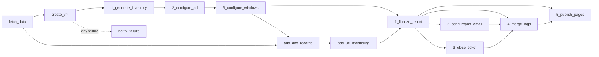

#### 5147 Python
#### 460  Pipeline
#### 512  Terraform
#### 330  Ansible

# VM Creation Automation

Ticket-driven VM provisioning for Abramad. When a Jira Service Management (JSM) request reaches the provisioning state, a GitLab CI pipeline reads the ticket, validates it against vCenter and NetBox, creates the VM(s) with Terraform, prepares Active Directory, Linux and the Windows guests with Ansible, creates DNS records in addition to Host and URL monitoring by Zabbix, publishes an HTML report to GitLab Pages, e-mails it, comments and closes the ticket.

## Contents

1. [Overview](#1-overview)
2. [How a run starts](#2-how-a-run-starts)
3. [Pipeline](#3-pipeline)
4. [How a ticket becomes infrastructure](#4-how-a-ticket-becomes-infrastructure)
5. [Repository layout](#5-repository-layout)
6. [Component reference](#6-component-reference)
7. [GitLab CI/CD variables](#7-gitlab-cicd-variables)
8. [Configuration dictionaries](#8-configuration-dictionaries-scriptsconfigspy)
9. [Observability and alerts](#9-observability-and-alerts)
10. [Reports and GitLab Pages](#10-reports-and-gitlab-pages)
11. [Running and testing locally](#11-running-and-testing-locally)
12. [Operations](#12-operations)
13. [Troubleshooting](#13-troubleshooting)
14. [Status and roadmap](#14-status-and-roadmap)
15. [Known issues and recommendations](#15-known-issues-and-recommendations)

---

## 1. Overview

| Concern | Tool |
|---|---|
| Request intake | Jira Service Management (`SERVICDESK` tickets) |
| Orchestration | GitLab CI, every job runs in the custom `tap` image |
| VM provisioning | Terraform 1.13 and `vmware/vsphere` provider 2.16.1, GitLab-managed HTTP state, **one state per ticket** |
| Guest and AD configuration | Ansible (WinRM for Windows and the domain controller, SSH for Linux) |
| IPAM | NetBox (public IP reservation) |
| DNS | Changes pushed to the BIND project |
| Monitoring | Customer Zabbix (URL monitoring, Windows agent), Prometheus Pushgateway, GitLab pipeline exporter |
| Reporting | HTML report per ticket on GitLab Pages, e-mailed to the customer contact, linked in the Jira closing comment |
| Notifications | Mattermost (failure channel and notify channel) |

| Datacenter | `vcenter_dict` key | Status |
|---|---|---|
| Vanak | `vanak` (`vts-lab-vc01`) | Implemented in all selectors |
| Vanak main | `vanak-main` (`vab-vc01`) | Dictionary entry exists, but name, template and Zabbix selectors only handle the key `vanak` (**TODO** confirm how this entry is meant to be activated) |
| Miremad | `miremad` | **Planned**: dictionary values are empty and the VM name and template selectors do not handle it yet |

## 2. How a run starts

Every job has `rules: if: $CI_PIPELINE_SOURCE == "trigger"`, so pipelines exist **only** when started through the GitLab pipeline trigger API (not on push or merge request). The Jira automation rule calls it when a ticket enters the provisioning state:

```bash
curl --fail -X POST \
  -F token=<TRIGGER_TOKEN> \
  -F ref=main \
  -F "variables[JIRA_TICKET_KEY]=SERVICDESK-12345" \
  https://gitlab.abramad.com/api/v4/projects/<PROJECT_ID>/trigger/pipeline
```

`JIRA_TICKET_KEY` is the only per-run input; everything else is read from the ticket.
`JIRA_SRV` (project variable, `test` or `main`) selects which set of Jira custom field IDs in `jira_field_dict` is used. It is **not** a server address.

## 3. Pipeline

### Flow



Jobs are connected with `needs:`, so a job starts as soon as its dependencies finish. Stages are only a grouping.

### Jobs

| Stage | Job | What it does | Main outputs | Failure behaviour |
|---|---|---|---|---|
| reconnaissance | `fetch_data` | Starts the timer, runs `scripts.data_fetcher <ticket>`: reads Jira, validates specs, picks names, templates, datastores and port groups, reserves public IPs in NetBox, writes the report | `vms.tfvars.json`, `reports/<ticket>/index.html`, logs | Runner failures retried. Pushes Pushgateway metrics |
| terraform_vm_provision | `create_vm` | Copies tfvars into `terraform/main`, `terraform init`, `terraform apply -auto-approve` (wrapped by `run_and_log`), exports `vm_ids` and `vm_ips` | `vm_outputs.json` | `retry: 0` |
| ansible_vm_provision | `1_generate_inventory` | Builds `ansible/inventory/hosts.yml` from tfvars and Terraform IPs, validates it with `ansible-inventory` | `hosts.yml` | Fails if a VM has no IP |
| | `2_configure_ad` | `configure_active_directory.yml`: OU, groups, users, computer objects | logs | Retried twice on `script_failure` |
| | `3_configure_windows` | `configure_windows_client.yml`: local groups, Zabbix Agent 2 | logs | Retried twice on `script_failure` |
| dns | `add_dns_records` | Adds records to the BIND project (`resource_group: bind_repo`) | logs | |
| zabbix | `add_url_monitoring` | Creates URL monitoring in the customer Zabbix | logs | `allow_failure: true` |
| reporting | `1_finalize_report` | Replaces the `{PRIVATE_IP:<vm>}` placeholders in the report with Terraform IPs | `reports/` | |
| | `2_send_report_email` | E-mails the report | | `allow_failure: true` |
| | `3_close_ticket` | Comments on and closes the Jira ticket with the report | | |
| | `4_merge_logs` | Merges every `automation.<job>.log` into `automation.log` | `automation.log` | |
| | `5_publish_pages` | Builds `log.html` and the index, sends the timing table to Mattermost, commits `reports/<ticket>` to `main` (`[skip ci]`), publishes Pages (`resource_group: pages_publish`) | `public/` | |
| catch_exception | `notify_failure` | Runs only on failure: posts failed jobs and log tails to the Mattermost failure channel | | |

Notes:
- Only `windows` and `linux` VMs go into the inventory, but **no job runs `configure_linux_client.yml` yet**.
- Artifacts expire after one day. The durable record of a run is `reports/<ticket>` in the repository and the Pages site.
- `3_close_ticket` depends only on `1_finalize_report`, so it can finish before the Pages site is published.
- Windows VMs are joined to the domain by Terraform (guest customization), then Ansible moves the computer objects into the customer OU.

## 4. How a ticket becomes infrastructure

`scripts/data_fetcher.py` turns the ticket into `vms.tfvars.json` with the keys `vcenter`, `vms` and `ad_info`. The selectors and validators live in `scripts/utility/functions/data_validators.py`.

### Server layout

| Product line | Category | Servers created | Names |
|---|---|---|---|
| Rahkaran Server | R Dev | 1 | `VRD-<base>` |
| | R I | 1 | `VR1-<base>` |
| | R II | 2 (App, DB) | `VR2-<base>-A1`, `VR2-<base>-DB` |
| | R III | 2 + N (DB, LB, N App) | `VR3-<base>-DB`, `VR3-<base>-LB`, `VR3-<base>-A1..AN` |
| Sepidar Server | | 1 | `VSP-<base>` |
| BI Server | | 1 | `VBI-<base>` |
| IaaS Server | | 1 | `VIA-<base>` |
| Managed IaaS Server | | 1 | `VMI-<base>` |
| Automation Server, SahamFasl Server | | 1 | `VAT-<base>`, `VSF-<base>` (name and Zabbix only, see below) |

`<base>` is the `vm_base_name` field (2 to 8 characters). A VM name must be unique in the whole vCenter (case-insensitive); otherwise the run fails.

### Per product line

| Product line | Template | Port group key | vCenter folder | Zabbix server | URL (only with public IP) |
|---|---|---|---|---|---|
| Rahkaran R Dev / R I | `RI` | `VRD` / `VRI` | `AbramadCustomers/Rahkaran/<base>` | `vnk-customerzabbix` | `https://<base>-r.abramad.cloud` |
| Rahkaran R II / R III | `RII-APP` for App and LB, `RII-DB` for DB (chosen from the VM name) | `VRII` / `VRIII` | same | same | same |
| Sepidar | `SEP` | `VSP` | `AbramadCustomers/Sepidar/<base>` | yes | none |
| BI | `BI` | `VBI` | `AbramadCustomers/BI/<base>` | yes | `https://<base>-b.abramad.cloud` |
| IaaS | by OS (below) | `VIA` | `AbramadCustomers/IaaS/<base>` | **none** | none |
| Managed IaaS | `MIaaS-W22` | `VMI` | `AbramadCustomers/ManagedIaaS/<base>` | yes | none |
| Automation, SahamFasl | **not implemented** | | **not implemented** | yes | |

IaaS template by the exact Jira OS text (case-insensitive): `Windows Server 2022` (uses `MIaaS-W22`), `Linux Ubuntu 24.04` (`IaaS-U24`), `Linux Ubuntu 26.04` (`IaaS-U26`), `Linux Rockey 9.8` (`IaaS-R98`), `Linux Oracle 9.0` (`IaaS-O9`). `os_type` is `windows` when the OS text starts with "windows", otherwise `linux`.

### Sizing and placement

- **CPU**: 2 up to `NORMAL_CLUSTER_CPU_LIMIT` / `HIGHPERF_CLUSTER_CPU_LIMIT` cores **per VM**, by the ticket processor type.
- **Memory**: 1 up to `NORMAL_CLUSTER_RAM_LIMIT` / `HIGHPERF_CLUSTER_RAM_LIMIT` GB **per VM**, converted to MB for Terraform.
- **Disks**: up to five per role (App, DB, LB). Each disk has a size and a tier (`standard`, `advanced`, `pro`, `ultra`) that maps to a datastore cluster in `vcenter_dict`. The datastore with the most remaining capacity below `DATASTORE_MAX_UTILIZATION` is chosen. Space already assigned to earlier disks of the same VM is reserved during the selection.
- **Compute cluster**: by processor type (`High Performance Processor`, `Normal Processor`).
- **Custom attributes**: `CompanyName`, `Creation Date` (Jalali, Tehran time), `Creation Ticket ID`, `National ID`, `NativeBackup`, `Physical Dongle`, `IDS/IPS`, `WAF Service`, `Site-to-Site VPN`, `Owner`, `ProductLine`, `Business Value`, `RepMail`, `RepName`, `RepNumber`; plus `Industry` (Rahkaran), `URL` and `Public IP` (Rahkaran main / App / LB server, BI), `Link-VraServer` (BI), `Sepidar-Lock` (Sepidar), `Public IP` (Sepidar, IaaS).

### Public IP

When `public_ip_needed` is set, an address is reserved in NetBox from the best prefix of the datacenter scope (`vanak` or `ME`, target `customers`). Rahkaran R I gets it on the main server, R II on the App server, R III on the LB; every other product line gets one per VM.

### Customer, AD and folders

- New customer: AD OU is the VM base name and the vCenter folder is derived from it. Existing customer: the OU and folder come from the ticket fields.
- Groups per customer: `<OU>Deploy`, `<OU>Support`, `<OU>Members`, `<OU>Computers`, and one `<OU><hostname>Members` per VM (created empty).
- Users: the **agent** (username is the national ID; member of `ADSelfServiceEnrollment` and `<OU>Members`) and, when all deployer fields are filled, a **deployer** (placed in `OU=Deploy`; member of `ADSelfServiceEnrollment`, `DeployMembers`, `<OU>Deploy`).
- Private IPs are not set by the pipeline: VMs are cloned without `ipv4_addr` (DHCP) and Terraform reports the address used by Ansible and the report.

## 5. Repository layout

```
.
├── .gitlab-ci.yml
├── README.md
├── ansible/
│   ├── ansible.cfg
│   ├── requirements.yml
│   ├── inventory/hosts.yml              generated on every run
│   ├── playbooks/                       configure_active_directory / configure_windows_client / configure_linux_client
│   └── roles/
│       ├── configure_active_directory/
│       └── configure_windows_client/
├── docker/                              build context of the "tap" image
├── reports/<TICKET>/                    index.html, log.html committed by 5_publish_pages
├── scripts/
│   ├── configs.py
│   ├── data_fetcher.py
│   └── utility/{ansible,dns,email,functions,gitlab,jira,log,mattermost,pipeline,webpage,zabbix}/
└── terraform/
    ├── main/                            root module, backend and providers
    └── modules/vm/                      VM module
```

## 6. Component reference

### 6.1 `docker/` (the `tap` image)

Used by every job (`${NEXUS_DOCKER_REGISTRY}/tap:1.0`). Contents: Python 3.12 slim, Terraform 1.13.0, `ansible-core` with `pywinrm` and `requests-ntlm`, collections from `docker/ansible/requirements.yml` (in `/usr/share/ansible/collections`), Python libraries from `docker/python/requirements.txt`, plus `git`, `jq`, `curl`, `openssh-client`, `sshpass`. The Terraform CLI config points providers to the Nexus mirror because outbound registries are blocked. Runs as the non-root user `pipeline`.

Build from the `docker/` directory:

```bash
docker build \
  --build-arg HTTP_PROXY=http://proxy.example.com:8080 \
  --build-arg HTTPS_PROXY=http://proxy.example.com:8080 \
  --build-arg NO_PROXY="localhost,127.0.0.1,.abramad.com,.cloud.local,.abramad.cloud" \
  -t ${NEXUS_DOCKER_REGISTRY}/tap:1.0 .
```

Python packages come from the Nexus PyPI proxy. Change `IMAGE_TAG` in `.gitlab-ci.yml` whenever the image changes.

### 6.2 `terraform/`

| Path | Purpose |
|---|---|
| `main/backend.tf` | Empty `http` backend; address, lock and credentials come from `TF_HTTP_*` set in `create_vm` (GitLab-managed state named after the ticket, authenticated with `CI_JOB_TOKEN`) |
| `main/providers.tf` | `vmware/vsphere` 2.16.1. The server comes from `var.vcenter.vc_addr`; user and password are read from `VSPHERE_USER` / `VSPHERE_PASSWORD`. `allow_unverified_ssl = true` |
| `main/variables.tf` | `vcenter`, `vms`, `ad_info`, `domain_join_user`, `domain_join_password`, `local_admin_password`, `custom_attribute_names` |
| `main/main.tf` | Calls `modules/vm`; outputs `vm_ids` and `vm_ips`. Commented placeholders for future `firewall-policy` and `dns-record` modules |
| `main/terraform.tfvars.json.example` | Example of the generated tfvars |
| `modules/vm/` | `data.tf` (lookups), `main.tf`, `variables.tf`, `outputs.tf`, `versions.tf` |

What `modules/vm/main.tf` does:
- Creates one `vsphere_folder` per distinct `vcenter_folder` path.
- Clones each VM from its template into the folder (EFI firmware, CPU and memory hot add on). The VM datastore is the datastore of the **first disk**; every disk is thin provisioned.
- Windows: sets computer name, local administrator password, joins the domain `ad_info.domain` with `domain_join_user` / `domain_join_password` and sets the time zone ID (`ad_info.timezone`, default 160). The computer object lands in the default container; Ansible moves it later.
- Linux: sets host name (lower case) and domain. Linux VMs are **not** domain joined.
- Network: DHCP unless `ipv4_addr` is set.
- Writes custom attributes. Keys not listed in `custom_attribute_names` are silently skipped, and the attribute must already exist in vCenter.
- `lifecycle.ignore_changes` covers `num_cpus`, `memory`, `disk` and `clone[0].customize`, so later resizing in vCenter or Jira does not change the VM through Terraform.

Input contract for each VM (`vms` map, key is the hostname):

| Field | Meaning |
|---|---|
| `os_type` | `linux` or `windows` |
| `zabbix_server` | Customer Zabbix server (`vnk-customerzabbix`, `me-customerzabbix`) or null for unmonitored product lines; also used by Ansible |
| `template_name`, `compute_cluster`, `vcenter_folder` | Source and placement |
| `num_cpus`, `memory` | CPU count and memory in **MB** |
| `disks[]` | `label` (`disk0`...), `size` (GB), `unit_number`, `datastore` (actual placement). `type` and `storage_cluster` are informational |
| `network` | `portgroup_name`; `ipv4_addr`, `subnet_mask`, `gw_addr`, `dns_*` optional |
| `custom_attrs` | Map of vCenter custom attributes |

### 6.3 `ansible/`

| Path | Purpose |
|---|---|
| `playbooks/configure_active_directory.yml` | Runs the AD role against `domain_controllers` |
| `playbooks/configure_windows_client.yml` | Runs the Windows role against `windows_clients` |
| `playbooks/configure_linux_client.yml` | **Planned**, not called by CI |
| `ansible.cfg` | **TODO** document (kept for later) |
| `inventory/hosts.yml` | Generated. Groups `domain_controllers` (`dc01`), `windows_clients`, `linux_clients`; credentials are `lookup('env', ...)` templates, never values. `windows_clients` hosts carry the `zabbix_server` host variable |
| `roles/configure_active_directory` | [Role README](ansible/roles/configure_active_directory/README.md) |
| `roles/configure_windows_client` | [Role README](ansible/roles/configure_windows_client/README.md) |

Playbooks run from `ansible/` with the whole tfvars file as extra vars (`-e "@../vms.tfvars.json"`), so roles can use `ad_info` and `vms`. WinRM uses HTTP 5985 with NTLM; SSH is used for Linux.

### 6.4 `scripts/`

Run as modules from the repository root with `PYTHONPATH=$CI_PROJECT_DIR`, for example `python3 -m scripts.data_fetcher SERVICDESK-12345`.

| Script | Purpose |
|---|---|
| `configs.py` | Environment variables and lookup dictionaries (sections 7 and 8) |
| `data_fetcher.py` | Reads the ticket, builds all VM data, writes `vms.tfvars.json`, the report and Pushgateway metrics |
| `utility/functions/data_validators.py` | Despite the name, it holds: vCenter connection and VM names, `pick_datastore`, name / template / port group / folder / URL / Zabbix / custom attribute selectors, CPU and memory validators, `disk_compactor`, the HTML `reporter()`, the SMTP sender `send_anonymous_email()`, and `tehran_datetime()` |
| `utility/functions/netbox.py` | NetBox client, best prefix search, IP reservation |
| `utility/ansible/generate_ansible_inventory.py` | Writes the Ansible inventory from tfvars and `vm_outputs.json` |
| `utility/dns/add_dns_records.py`, `dns_resolver.py` | Adds records through the BIND project; resolves names against `DNS_SERVER` |
| `utility/email/send_report_email.py` | Sends the report (uses `MAIL_SERVER`, `CC_EMAIL`). The sender talks plain SMTP on port 25 with no authentication |
| `utility/gitlab/get_failed_jobs.py` | Last 40 log lines of every failed job of the current pipeline |
| `utility/jira/close_ticket.py` | Comments with the report and closes the ticket |
| `utility/log/logger.py` | JSON logger writing `automation.<job>.log` |
| `utility/log/run_and_log.py` | `run_and_log <ticket> <source> -- <command...>`: runs a command, streams output, strips ANSI codes and stores the whole output as one log record |
| `utility/log/merge_logs.py` | Merges job logs into `automation.log` |
| `utility/mattermost/notifier.py` | Sends messages to a webhook |
| `utility/pipeline/timing.py` | `start`, `mark <name>`, `summary` |
| `utility/webpage/*` | `generate_log.sh`, `generate_index.sh`, HTML templates, `patch_report_ips.py` |
| `utility/zabbix/add_url_monitoring.py` | URL monitoring in the Vanak or Miremad customer Zabbix |

## 7. GitLab CI/CD variables

**Required** means `configs.py` reads it with `os.environ[...]`; every script that imports `configs.py` fails with `KeyError` if it is missing. Mark every secret as **Masked** and **Protected**.

### 7.1 Defined in `.gitlab-ci.yml`

| Variable | Value | Purpose |
|---|---|---|
| `IMAGE_NAME` | `${NEXUS_DOCKER_REGISTRY}/tap` | Job image repository |
| `IMAGE_TAG` | `1.0` | Job image tag |
| `ANSIBLE_ROLES_PATH` | `${CI_PROJECT_DIR}/ansible/roles` | Role lookup |

### 7.2 Project variables

| Variable | Req. | Used by | Purpose |
|---|---|---|---|
| `NEXUS_DOCKER_REGISTRY` | yes | `.gitlab-ci.yml` | Registry that hosts the `tap` image |
| `JIRA_TICKET_KEY` | yes | everything | Passed by the trigger. Used for the Terraform state name, report path, logs and Jira calls |
| `JIRA_SRV` | yes | `data_fetcher` | `test` or `main`: selects `jira_field_dict` |
| `JIRA_ADDR` | yes | Jira scripts | Jira base URL |
| `JIRA_TOKEN` | yes | Jira scripts | Jira API token (read ticket, comment, transition) |
| `JIRA_CLOSE_TRANSITION_NAME` | no (`close`) | `close_ticket.py` | Transition used to close the ticket (ID 101 in test) |
| `VSPHERE_USER`, `VSPHERE_PASSWORD` | yes | `data_fetcher`, Terraform provider | vCenter service account. Terraform reads these exact names from the environment |
| `NORMAL_CLUSTER_CPU_LIMIT` | no (`30`) | `cpu_validator` | Maximum vCPU **per VM** for the Normal processor type (minimum is 2) |
| `HIGHPERF_CLUSTER_CPU_LIMIT` | no (`48`) | `cpu_validator` | Same for High Performance |
| `NORMAL_CLUSTER_RAM_LIMIT` | no (`128`) | `memory_validator` | Maximum memory **per VM** in GB for Normal (minimum is 1) |
| `HIGHPERF_CLUSTER_RAM_LIMIT` | no (`256`) | `memory_validator` | Same for High Performance |
| `DATASTORE_MAX_UTILIZATION` | no (`80`) | `pick_datastore` | Maximum datastore usage in percent after the new disk is added |
| `DOMAIN` | no (`cloud.local`) | `data_fetcher` | AD domain written to `ad_info.domain` |
| `DOMAIN_JOIN_USER`, `DOMAIN_JOIN_PASSWORD` | yes | `create_vm` (as `TF_VAR_*`) | Account that joins new Windows VMs to the domain |
| `LOCAL_ADMIN_PASSWORD` | yes | `create_vm` (as `TF_VAR_local_admin_password`) | Local administrator password for Windows VMs. The AD role also uses a variable named `local_admin_password` as the initial password of new AD users (**TODO** confirm where the playbook sets it) |
| `AD_SERVER` | yes (Ansible) | inventory | Domain controller address (`dc01`) |
| `AD_ANSIBLE_USER`, `AD_ANSIBLE_PASSWORD` | yes (Ansible) | inventory | WinRM account on the domain controller |
| `WINDOWS_ANSIBLE_USER`, `WINDOWS_ANSIBLE_PASSWORD` | yes (Ansible) | inventory | WinRM account on Windows guests |
| `LINUX_ANSIBLE_USER` | yes (Ansible) | inventory | SSH user for Linux guests |
| `LINUX_SSH_PRIVATE_KEY` | yes (Ansible) | inventory | Must be a **File** type variable: its value is the key path used as `ansible_private_key_file` |
| `NETBOX_URL`, `NETBOX_TOKEN` | yes | `netbox.py` | NetBox API |
| `DNS_SERVER` | yes | `dns_resolver.py` | DNS server used to resolve `abramad.cloud` records |
| `PUBLIC_ZONE` | yes | DNS scripts | Public zone for records |
| `BIND_PUSH_TOKEN` | yes | `add_dns_records.py` | Pushes DNS changes to the BIND project |
| `GIT_PUSH_TOKEN` | yes | `5_publish_pages` | Pushes `reports/<ticket>` to `main` (needs `write_repository` and permission on the protected branch) |
| `GIT_API_TOKEN` | yes | `get_failed_jobs.py` | Reads pipeline jobs and traces (`read_api` should be enough, **TODO** verify) |
| `VNK_CUSTOMERZABBIX_URL`, `VNK_CUSTOMERZABBIX_TOKEN` | yes | `add_url_monitoring.py` | Vanak customer Zabbix API |
| `ME_CUSTOMERZABBIX_URL`, `ME_CUSTOMERZABBIX_TOKEN` | yes | `add_url_monitoring.py` | Miremad customer Zabbix API |
| `PUSHGATEWAY_URL` | yes | `data_fetcher.py` | Pushgateway for the data fetcher metrics |
| `MATTERMOST_NOTIFY_WEBHOOK` | yes | `timing.py summary` | Success channel (stage timing table) |
| `MATTERMOST_FAILURE_WEBHOOK` | yes | `notify_failure` | Failure channel |
| `MAIL_SERVER`, `CC_EMAIL` | yes | `send_report_email.py` | SMTP server and CC address |

### 7.3 Set inside jobs (do not create as project variables)

| Variable | Set in | Purpose |
|---|---|---|
| `TF_VAR_domain_join_user`, `TF_VAR_domain_join_password`, `TF_VAR_local_admin_password` | `create_vm` | Terraform sensitive inputs |
| `TF_STATE_NAME`, `TF_ADDRESS`, `TF_HTTP_ADDRESS`, `TF_HTTP_LOCK_ADDRESS`, `TF_HTTP_UNLOCK_ADDRESS`, `TF_HTTP_USERNAME`, `TF_HTTP_PASSWORD`, `TF_HTTP_LOCK_METHOD`, `TF_HTTP_UNLOCK_METHOD`, `TF_HTTP_RETRY_WAIT_MIN` | `create_vm` | GitLab-managed Terraform state per ticket, authenticated by `CI_JOB_TOKEN` |

### 7.4 GitLab predefined variables in use

`CI_PIPELINE_SOURCE` (must be `trigger`), `CI_PROJECT_DIR`, `CI_JOB_NAME` (log file `automation.<job>.log`, `/` and `:` replaced by `_`), `CI_JOB_TOKEN`, `CI_API_V4_URL`, `CI_PROJECT_ID`, `CI_PIPELINE_ID`, `CI_PIPELINE_URL`, `CI_PROJECT_NAME`, `CI_PAGES_URL`.

## 8. Configuration dictionaries (`scripts/configs.py`)

- **`template_dict`**: product / OS key to vCenter template. `IaaS-W22` is defined but not used by `template_selector` today.
- **`vcenter_dict`**: per datacenter: `addr`, `dc`, `compute_cluster` (by processor type), `storage_cluster` (by tier), `portgroup` (by network code such as `VRI`, `VBI`, `MRI`). Lookups use the key **exactly as written**, so the datacenter text from Jira must match a lower-case key.
- **`jira_field_dict`**: Jira custom field IDs for `test` and `main`: general fields, yes/no flags, agent and deployer contact fields, and App / DB / LB sizing (memory, CPU, disk count, up to five disks with size and type).

`miremad` values and the Jira `main` set are **Planned**.

## 9. Observability and alerts

| What | How |
|---|---|
| Data fetcher health | `data_fetcher.py` pushes to the Pushgateway: job `python_scripts`, instance `vm_creation_data_fetcher`, target `vm_specs`, label `datacenter`. Metrics: `script_exec_duration_seconds`, `script_success` (1 or 0), `script_last_error_message{error_summary,error_detail}`. Alerts exist on these. **TODO** list the rule names |
| Pipeline status | GitLab pipeline exporter scraped by Prometheus (job `gitlab-pipeline-exporter`), rules below |
| Why a pipeline failed | `notify_failure` runs `get_failed_jobs.py`: for every failed job it posts name, stage and the last 40 log lines to the Mattermost failure channel, with the pipeline URL and ticket key |
| Stage timing | `timing.py` writes one JSON file per mark into `pipeline_timing/` (`pipeline_start`, `reconnaissance_end`, `terraform_end`, `ansible_start`, `ansible_end`, `dns_end`, `zabbix_end`, `reporting_start`, `reporting_end`). `5_publish_pages` posts a table to the Mattermost notify channel. Missing marks show as `skipped` |
| Logs | Every job writes JSON lines to `automation.<job>.log`; `run_and_log` stores the full Terraform / Ansible output as one record (`issue`, `source`, `exit_code`, `line_count`); `4_merge_logs` merges them and `generate_log.sh` renders `log.html` |

### Prometheus rules (`gitlab_pipeline_exporter_alerts`)

| Alert | Expression | For | Severity / channel | Meaning |
|---|---|---|---|---|
| `CICDPipelineFailed` | `gitlab_ci_pipeline_status{status="failed"} == 1` | 1m | critical, sms | Latest pipeline of a project / ref is failed (all projects, not only this one). It stays active until the next pipeline of that ref finishes |
| `GitlabPipelineExporterDown` | `up{job='gitlab-pipeline-exporter'} == 0` | 5m | critical, sms | Exporter cannot be scraped: pipeline alerting is blind |
| `VmCreationPipelineSlow` | `gitlab_ci_pipeline_duration_seconds{project="abramad/sysops/automation/vm-creation"} > 1500` | 1m | warning | Last run took longer than 1500 s (25 minutes). The annotation says "20m baseline": make them agree |

## 10. Reports and GitLab Pages

Pages URL: `http://abramad.reports.abramad.com/sysops/automation/vm-creation/` (also `${CI_PAGES_URL}`).

- `reports/<TICKET>/index.html` is the **customer report**: a Persian, right-to-left, e-mail style page with the VPN/RDP user name (`<national id>@cloud.local`), instructions to set the password at `selfservice.abramad.com` and the password policy, FortiClient guides and download for Vanak and Miremad, and per VM: name, CPU, memory, private IP (`{PRIVATE_IP:<vm>}` placeholder replaced by `1_finalize_report`), public IP, URL and disks. It contains no passwords. **TODO** confirm that `send_report_email.py` uses this file as the e-mail body.
- `reports/<TICKET>/log.html` is the merged log of the run.
- The Pages root is a static searchable list of all tickets with links to both pages, generated by `generate_index.sh` from the `reports/` folder (footer shows the last update in Jalali time).
- `5_publish_pages` commits `reports/<TICKET>` to `main` (`vm-creation-bot`, message `Finalize report and logs for <TICKET> [skip ci]`) and publishes `public/`. Runs are serialized with `resource_group: pages_publish`.

**TODO** document who can open the Pages site and how long reports are kept.

## 11. Running and testing locally

Scripts need the same environment as CI, so use the image:

```bash
docker run --rm -it -v "$PWD:/workspace" -w /workspace \
  --env-file .env.local \
  ${NEXUS_DOCKER_REGISTRY}/tap:1.0 bash

export PYTHONPATH=/workspace
python3 -m scripts.data_fetcher SERVICDESK-12345      # writes vms.tfvars.json and the report
```

- Create `.env.local` from the variables in section 7 and **never commit it**. Use `JIRA_SRV=test` and test tokens.
- `configs.py` reads all required variables at import time, so set every one of them even for a single script.
- Without CI, `CI_PROJECT_DIR` defaults to `.` and `CI_JOB_NAME` to `local`.
- `data_fetcher.py` reserves public IPs in NetBox and connects to vCenter, so point `NETBOX_URL` and `VSPHERE_*` at test systems.
- Terraform: `terraform -chdir=terraform/main init -backend=false && terraform -chdir=terraform/main validate`.
- Ansible: `ansible-playbook --syntax-check -i ansible/inventory/hosts.yml ansible/playbooks/<playbook>.yml`.

## 12. Operations

**Re-running a ticket.** Terraform state is per ticket, but `data_fetcher` rejects any VM name that already exists in vCenter, **even if it was created by the same ticket**. A re-run after a partial or successful apply therefore stops at `fetch_data` with "VM name ... already exists in vCenter". Before re-triggering, remove the VMs (for example `terraform destroy` against state `<TICKET>`, or delete them in vCenter) and the Terraform state, then clean NetBox IPs reserved by the first run. **TODO** confirm the supported procedure.

**Rolling back.** There is no destroy job yet. To remove a ticket's VMs run `terraform destroy` with the state `<TICKET>` and the saved `vms.tfvars.json`, then clean AD objects, DNS records, NetBox IPs and Zabbix items manually.

**Adding a product line.** Update `vm_name_selector`, `template_selector`, `portgroup_selector`, `vcenter_folder_selector`, `zabbix_server_selector`, `attribute_selector` and, if it needs a URL, `url_selector`, plus the server layout in `data_fetcher.py`.

**Adding a template.** Add it to `template_dict`, make sure it exists in vCenter, and update `template_selector` and the Jira OS options (the text must match exactly).

**Adding a datacenter.** Fill a complete `vcenter_dict` entry, add the customer Zabbix URL / token variables and an agent config folder under `ansible/roles/configure_windows_client/files/zabbix/config_files/`, and extend the datacenter handling in `vm_name_selector`, `template_selector`, `zabbix_server_selector`, the NetBox scope in `data_fetcher.py` and `add_url_monitoring.py`.

**Adding a Jira field.** Add its ID to **both** `test` and `main` in `jira_field_dict`, read it in `data_fetcher.py`, and pass it on through the selectors or tfvars.

**Adding a vCenter custom attribute.** Create it in vCenter first, then add the exact name to `custom_attribute_names` in the Terraform module.

**Upgrading Zabbix Agent 2.** Change `agent2_version` in the Windows role defaults.

## 13. Troubleshooting

| Symptom | Check |
|---|---|
| `KeyError: 'SOME_VAR'` at job start | A required CI variable is missing, or it is Protected and the pipeline ref is not protected |
| `fetch_data` fails and no metrics arrive | The failure happened before the `try` block (Jira access, an empty yes/no field). Read the job log |
| `No automation procedure available for datacenter` | The datacenter is not implemented in the selector (only `vanak` is) |
| `VM name '...' already exists in vCenter` | Name collision, or a re-run of a ticket whose VMs already exist (section 12) |
| `VM base name ... must be between 2-8 characters` | Fix `vm_base_name` in the ticket |
| `VM memory / CPU must be between ...` | Value outside the per-VM limits for the processor type |
| `No datastore in cluster ... can accommodate disk` | Datastore cluster is above `DATASTORE_MAX_UTILIZATION` |
| `Template ... not found` / `No templates found` | Product line or OS text not supported by `template_selector` |
| `create_vm` fails with a state lock error | Another run or a stuck job holds the state `<TICKET>`: unlock it under Operate, Terraform states |
| `No Terraform Private IP found for VM` | VMware Tools did not report an IP; check the VM console and DHCP |
| `2_configure_ad` fails | See the AD role README: check WinRM from the runner to `AD_SERVER`, rights on `OU=Customers`, and that `OU=Deploy` and the shared groups exist |
| `3_configure_windows` fails on the Zabbix config | The VM has no `zabbix_server` (unmonitored product line such as IaaS) |
| Pipeline failed but no Mattermost message | `notify_failure` only runs for hard failures; `add_url_monitoring` and `2_send_report_email` are `allow_failure` |
| Report shows `{PRIVATE_IP:...}` | `1_finalize_report` did not replace the placeholder (missing IP in `vm_outputs.json`) |
| Pages not updated | Check `5_publish_pages`, the `pages_publish` queue and whether the push to `main` was rejected |

## 14. Status and roadmap

| Item | Status |
|---|---|
| Vanak (`vanak` key) end to end for Rahkaran, Sepidar, BI, IaaS, Managed IaaS | Working |
| `vanak-main` selectors | **Planned / TODO** confirm |
| Miremad datacenter (dictionary values and selectors) | Planned |
| Jira `main` field IDs | Planned |
| Automation Server and SahamFasl Server product lines | Partial: names and Zabbix only |
| Linux guest configuration (`configure_linux_client.yml`, `ansible.cfg` docs) | Planned |
| Splunk forwarder on Windows | Disabled in the role |
| Terraform `firewall-policy` and `dns-record` modules | Placeholders in `terraform/main/main.tf` |
| Pushgateway metrics for stages other than `fetch_data` | Not planned: the pipeline exporter is used |

## 15. Known issues and recommendations

Prioritized. **High** items can break a run or expose data. Items marked "verify" are based on reading the code and should be confirmed.

### Code behaviour

| Priority | Finding | Suggestion |
|---|---|---|
| High | `data_fetcher.py`, existing-customer branch: `vcenter_folder_selector(...)` result is not assigned, so `vcenter_folder` is undefined. In addition `vsphere_folder.customer_folder` always tries to **create** the folder, which already exists for an existing customer (verify) | Assign the result, and in Terraform only create folders for new customers (or use a data source for existing ones) |
| High | Ticket parsing and yes/no flags (`.value.strip()` on an empty field) run **outside** the `try` block, so an empty field raises `AttributeError` with no metrics, no structured log and no summary | Move everything after `JIRA(...)` into the `try`, or read fields through a helper |
| High | `finally: Disconnect(si)` raises `NameError` when the error happens before `si` exists (for example unsupported datacenter), hiding the real error and skipping the Pushgateway push | Initialize `si = None` and disconnect only when set |
| High | `computer.yml` loops over **all** VMs in `vms`, including Linux VMs that are not domain joined. `microsoft.ad.computer` with `state: present` creates missing objects (verify) | Loop only over `os_type == 'windows'` VMs |
| High | `zabbix_agent2.yml` copies `zabbix/config_files/{{ zabbix_server }}/...`; `zabbix_server_selector` returns null for unmonitored product lines (for example IaaS), so a Windows IaaS VM fails here | Skip the task when `zabbix_server` is empty |
| Medium | `template_selector` leaves `template_name` unset for unmatched cases (R II / III name not matching, unknown IaaS OS), causing `UnboundLocalError`. Windows IaaS uses the `MIaaS-W22` template while `IaaS-W22` is never used (verify) | Use an explicit `else` raising a clear error; check the Windows IaaS mapping; choose App / DB / LB by role, not by regex on the name |
| Medium | `vm_name_selector` blocks re-runs for VMs created by the same ticket | Allow names whose `Creation Ticket ID` custom attribute equals the ticket |
| Medium | `pick_datastore` is called per VM and re-reads vCenter free space each time, so the VMs of one ticket (R II / R III) can all choose the same datastore and exceed the limit | Carry the reservation across VMs of the same run |
| Medium | `nb_scope` is only set for `vanak` and `miremad`. `compute_cluster` and `disk_compactor` look up `vcenter_dict` without `.lower()`, while `data_fetcher` uses `.lower()` for the vCenter entry | Normalize the datacenter once and use it everywhere |
| Medium | `cpu_validator` error message always prints `VSPHERE_HIGHPERF_CLUSTER_CPU_LIMIT` as the maximum, even for the Normal type | Print `max_cpu_cores` |
| Medium | `reporter()` reads `vm.get('vm_lock_addr')` for Sepidar, which is never set (the value is in `custom_attrs['Sepidar-Lock']`), so the report always shows `N/A` | Read the correct key |
| Medium | `reporter()` writes ticket values into HTML without escaping, hard-codes `@cloud.local` and prints `None@cloud.local` when the agent national ID is empty | Use `html.escape`, use `DOMAIN`, and validate agent fields |
| Medium | `run_and_log.py` logs **failed** commands with `logger.info` (both branches are identical) and crashes with `ValueError` if `--` is missing | Use `logger.error` for non-zero exit codes and validate arguments |
| Medium | Every function in `data_validators.py` repeats a 20-line `except` block that changes `success` and `error_string_*` globals. They are module globals of `data_validators`, not the ones `data_fetcher` uses, so the values are never read, and errors are logged twice | Remove the duplicated blocks or replace them with one decorator that logs and re-raises |
| Medium | `data_validators.py` mixes unrelated concerns (vCenter, selectors, e-mail, HTML report) and `import *` is used widely | Split into `vcenter.py`, `selectors.py`, `reporter.py`, `mailer.py` and import explicitly |
| Medium | `generate_ansible_inventory.py` uses `vm_issue` after the loop; undefined if no VM is processed | Initialize it before the loop |
| Low | `add_url_monitoring` shares `resource_group: bind_repo` with DNS | Confirm it is intended |
| Low | The Pages index placeholder reads `SERVICEDESK-83929` (extra E) while tickets are `SERVICDESK-...`; the list is oldest-first | Fix the text and show newest first |
| Low | `ansible_start` mark is written but unused; timing summary only exists when the pipeline reaches `5_publish_pages` | Use it or remove it |
| Low | `2_configure_ad` and `3_configure_windows` retry on `script_failure` | Keep every task idempotent. The Zabbix task restarts the service on every run |

### Security and data protection

| Priority | Finding | Suggestion |
|---|---|---|
| High | New AD users (agent and deployer) get `local_admin_password` as initial password: the same shared value as the local administrator password of every Windows VM. It is expired at creation but still valid until changed | Use a random per-user initial password nobody needs to know (users reset it at `selfservice.abramad.com`), and use `no_log: true` on those tasks |
| High | `LOCAL_ADMIN_PASSWORD` is one value for every customer VM | Generate a unique password per VM and store it in a secrets manager (or LAPS) |
| High | Terraform state contains the customization values (domain join and local admin passwords) in plain text, stored in GitLab per ticket | Restrict who can read Terraform states and job artifacts (Maintainer or higher) |
| High | The Pages site is plain HTTP and lists every ticket. Each report contains the agent national ID (as the VPN user name), hostnames, private and public IPs and URLs | Serve Pages over HTTPS, restrict access (GitLab Pages access control or the reverse proxy), and consider masking the national ID in published copies |
| High | `JIRA_TICKET_KEY` is used in file paths, the state name and `git add` | Validate it at the start of `fetch_data` (for example `^SERVICDESK-[0-9]+$`) and check the ticket status |
| Medium | TLS is not verified anywhere: `ssl.CERT_NONE` for vCenter (Python), `allow_unverified_ssl = true` (Terraform), `validate_certs: false` for the Nexus download, `ansible_winrm_server_cert_validation: ignore` | Trust the internal CA in the image and enable verification |
| Medium | WinRM uses HTTP 5985 with NTLM | Move to HTTPS 5986 or Kerberos |
| Medium | Tokens are placed in the git remote URL in `5_publish_pages` | Use a credential helper or `GIT_ASKPASS`; keep tokens Masked and Protected |
| Medium | Image build: `ansible-core` unpinned and Nexus accessed over plain HTTP | Pin versions (ansible-core, collections, packages, base image digest) and use HTTPS |
| Medium | The e-mail is sent as plain SMTP without authentication or TLS | Acceptable only on a trusted network; restrict by relay ACL |
| Low | Token scopes | Least privilege (`read_api` for `GIT_API_TOKEN`), rotate on a schedule |

### Reliability

| Priority | Finding | Suggestion |
|---|---|---|
| High | `fetch_data` has side effects (public IPs are reserved in NetBox). A failed or repeated run can leave reserved IPs | Make reservation idempotent (find by `<name> - <ticket>` first) and release IPs when the pipeline fails |
| Medium | `terraform apply -auto-approve` with no plan stage or approval, and no destroy job | Add a plan artifact, a manual gate for production and a manual `destroy_vm` job |
| Medium | Two tickets for the same vCenter can run at once and pick the same names or datastores | Add `resource_group: vcenter_<datacenter>` to `fetch_data` and `create_vm` |
| Medium | `allow_failure` jobs (Zabbix, e-mail) can fail without any Mattermost message or alert | Notify on warnings or from those jobs |
| Medium | On failure nothing is written to Jira and no report is published | Let `notify_failure` comment on the ticket and publish a partial report |
| Medium | `CICDPipelineFailed` is global, pages SMS and stays firing until the next pipeline of the same ref finishes; all ticket pipelines use `main`, so one failed ticket hides the next failure | Add a project label and consider a per-ticket or time-limited alert |
| Medium | Linux VMs are created and put in the inventory but never configured | Add the role and job, or document that Linux VMs are delivered unconfigured |
| Low | `VmCreationPipelineSlow` threshold (25 m) and description (20 m) disagree | Align them |
| Low | No `timeout` or `interruptible` settings | Add per-job timeouts |
| Low | VMs use DHCP and the address is read back from Terraform | Reserve private IPs in NetBox and set `ipv4_addr` so DNS and monitoring cannot drift |

### Maintainability

- `data_fetcher.py` repeats the same `getattr(...) if ... else ...` expression for about 90 fields. A helper such as `field(issue, "app_disk1_size", cast=int, default=0)` and a loop over the `app` / `db` / `lb` roles would shrink it a lot and make it testable.
- Keep `success`, `error_string_summary` and `error_string_detail` out of `configs.py`.
- The limit variables are named `*_CLUSTER_*_LIMIT` but are **per-VM** maxima, and are stored as `VSPHERE_*` constants; rename them consistently (for example `MAX_VM_CPU_NORMAL`).
- Build `jira_field_dict["main"]` from `test` plus overrides while `main` is being filled in.
- Read required variables lazily (per module) so a script does not fail because of an unrelated variable.
- Terraform: the root and the module both define `custom_attribute_names`, `ad_info` and the VM object; keep one definition (the root `ad_info` has `domain_join_user`, the module does not).
- `local_groups.yml` hard-codes the NetBIOS domain `cloud\` and the AD role hard-codes `DC=cloud,DC=local`; derive both from `ad_info.domain`.
- The repository URL in `5_publish_pages` is hard-coded; use `${CI_SERVER_HOST}/${CI_PROJECT_PATH}`.
- `ansible/inventory/hosts.yml` is tracked but overwritten on every run. Track an example and add the real one to `.gitignore`, together with `vms.tfvars.json`, `terraform/main/vms.tfvars.json`, `.terraform/`, `automation*.log`, `public/`, `pipeline_timing/` and `.env*`.
- Add merge request pipelines: `terraform fmt` / `validate`, `tflint`, `ansible-lint`, `yamllint`, `ruff`, and unit tests for the selectors and validators with a mocked Jira issue.
- Reports grow the repository forever. Consider a dedicated reports repository or a retention policy.
- Add a CHANGELOG, CODEOWNERS, an architecture diagram and a sample Jira request with its resulting `vms.tfvars.json`.